<p align="center">
  
</p>

<h1 align="center">Guild Book</h1>

<p align="center">
  <strong>One library of AI skills for your whole team, in every AI tool.</strong><br />
  Keep your team's skills and instructions in git. The app links them into Claude Code, Codex, Cursor and more.
</p>

<p align="center">
  <a href="LICENSE"></a>
  
  
</p>

<p align="center">
  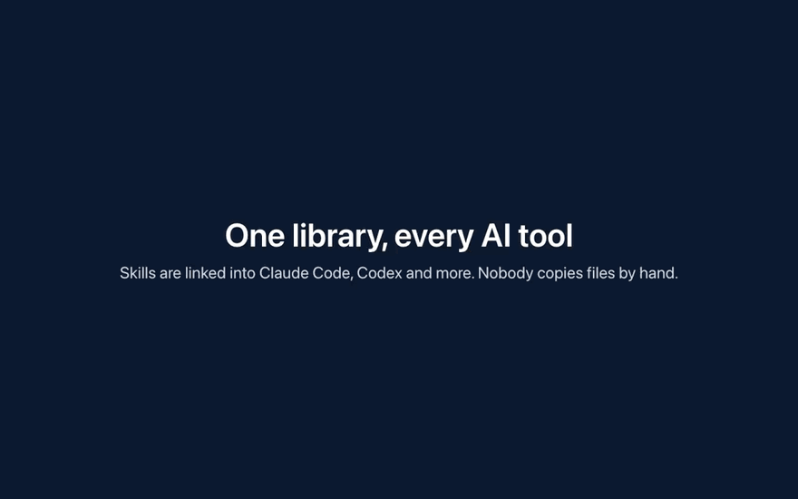
</p>

## Why

Every AI coding tool reads skills from its own folder. A team that shares skills ends up copying files by hand, and the
copies drift apart. A skill that one person improves never reaches the others.

Guild Book fixes this. Your team keeps its **skills** (`SKILL.md`) and **instructions** (`AGENTS.md`) in one git
repository, the _library_. The app brings the library to each computer and **links** it into the folders that your AI
tools read. When someone improves a skill, everyone gets it with one pull.

**Why the name?** A guild keeps what it knows about its craft in one shared book. Guild Book does the same for the AI
skills of your team.

## What it does

- **One library, every tool.** Skills and instructions live in one place. The app links them into each tool's own folder
  with symbolic links, so there are no copies to keep in sync.
- **Your git, your files.** GitHub, GitLab, Gitea or any git server, over HTTPS or SSH. The files stay in open formats
  ([Agent Skills](https://agentskills.io) and `AGENTS.md`). There is no cloud service to sign up for, and no lock-in.
- **A git client made for skills.** See what changed, commit, pull, push, branch, stash and resolve conflicts side by
  side. Nothing changes on your computer until you confirm a preview.
- **Edit and import.** A form for the name, description and tags, a rich text editor, and the raw file when you want it.
  Bring skills from an old repo, a folder or a zip, and review each one before it is added.
- **Skills where you need them.** Make a skill available everywhere, or only in the code repos that need it, with tags
  and lasting rules. One overview shows where every skill goes.
- **Shared instructions.** A company's `AGENTS.md` reaches each tool's global instructions. Your own text is never touched.
- **Made for teams.** Roles follow your git host. Open a change request when the main branch is protected, sign commits
  where the host requires it, welcome new people with an invite link, and join as many libraries as you need.
- **Safe by design.** The app never overwrites your own files. It asks first when a name is taken, scans what you push
  for secrets, reads only the folders you give it, and sends no telemetry. "Needs attention" and the Doctor explain every
  problem in plain words.

## See it work

<p align="center">
  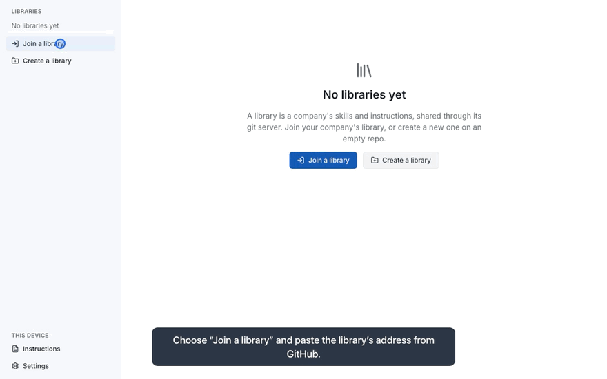<br />
  <sub><b>Join a library from GitHub.</b> Paste the address. Approve a short code in your browser. The app asks for no password and no ID.</sub>
</p>

<table>
  <tr>
    <td width="50%" valign="top">
      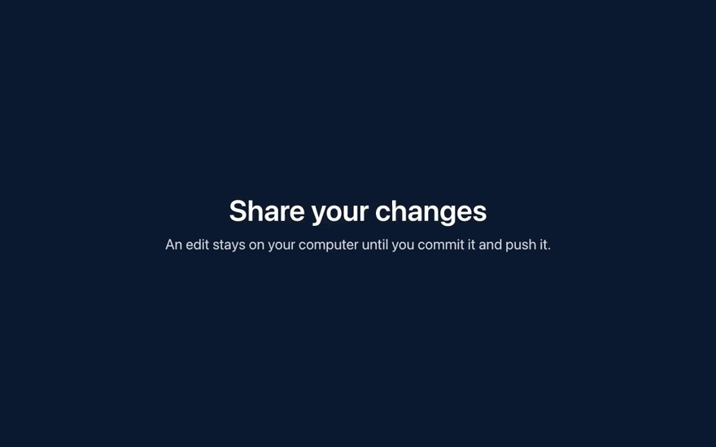<br />
      <sub><b>Share a change.</b> An AI tool improves a skill. You review the change, commit and push.</sub>
    </td>
    <td width="50%" valign="top">
      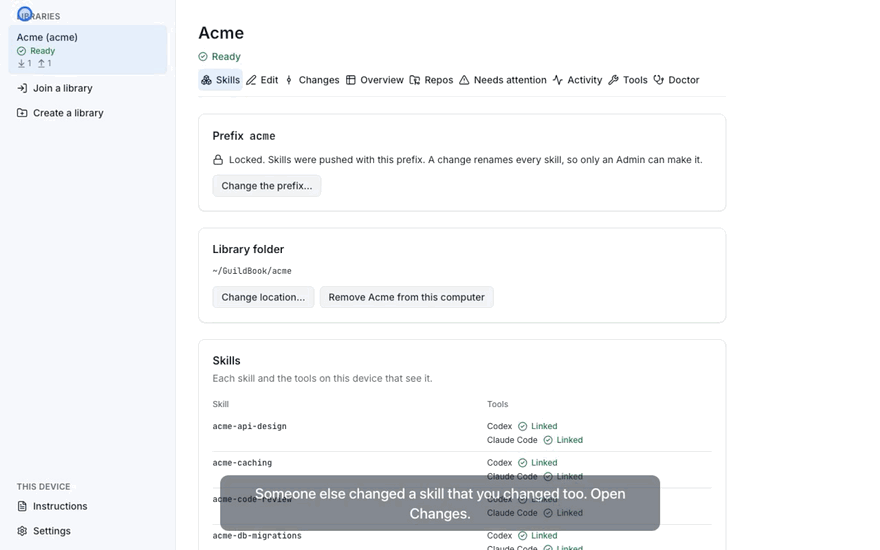<br />
      <sub><b>Resolve a conflict.</b> Two people changed the same line. The app shows both versions.</sub>
    </td>
  </tr>
  <tr>
    <td width="50%" valign="top">
      <br />
      <sub><b>Skills in your repos.</b> Tag a skill, and it goes only into the repos that need it.</sub>
    </td>
    <td width="50%" valign="top">
      <picture>
        <source media="(prefers-color-scheme: dark)" srcset="docs/media/screens/attention-dark.png" />
        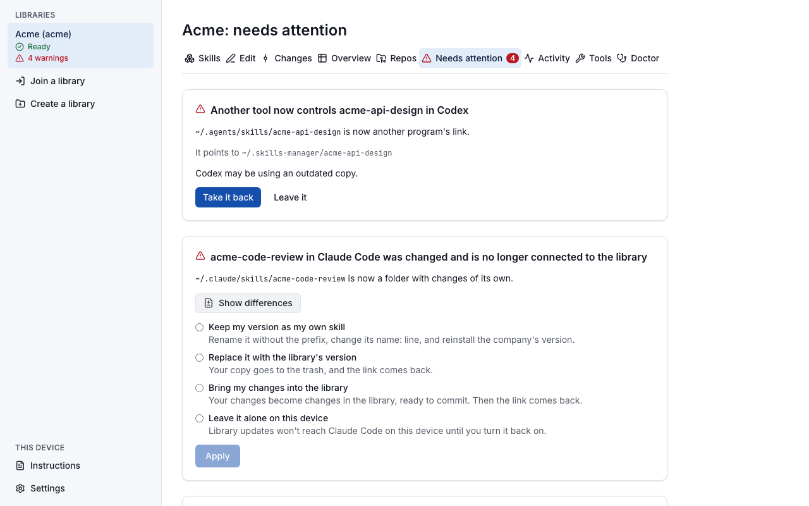
      </picture><br />
      <sub><b>Never overwritten.</b> If a name is taken, the skill waits and you decide.</sub>
    </td>
  </tr>
</table>

<details>
<summary><b>More pictures</b></summary>
<br />

<table>
  <tr>
    <td width="50%" valign="top">
      <picture>
        <source media="(prefers-color-scheme: dark)" srcset="docs/media/screens/skills-dark.png" />
        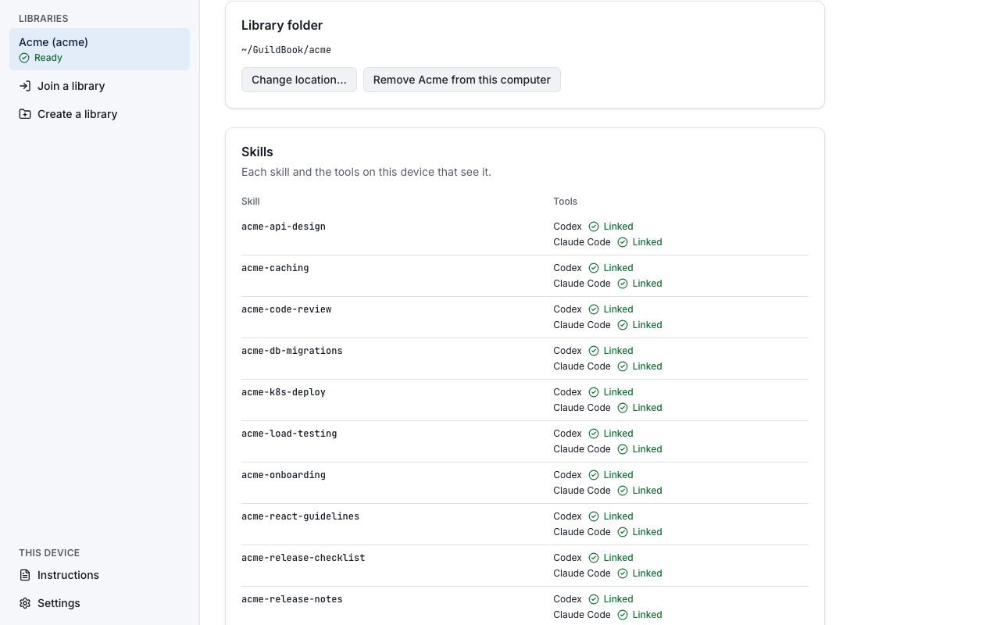
      </picture><br />
      <sub><b>Skills.</b> Where each skill is linked on this computer.</sub>
    </td>
    <td width="50%" valign="top">
      <picture>
        <source media="(prefers-color-scheme: dark)" srcset="docs/media/screens/overview-dark.png" />
        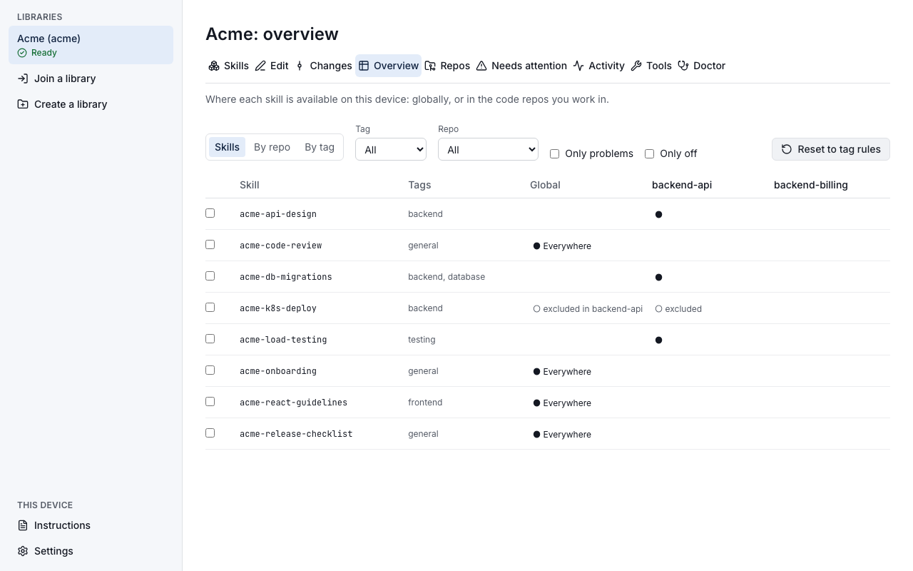
      </picture><br />
      <sub><b>Overview.</b> Every skill, and where it is available.</sub>
    </td>
  </tr>
  <tr>
    <td width="50%" valign="top">
      <picture>
        <source media="(prefers-color-scheme: dark)" srcset="docs/media/screens/editor-dark.png" />
        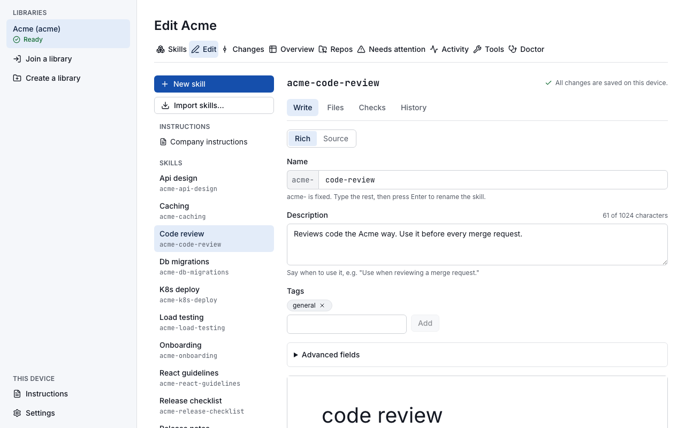
      </picture><br />
      <sub><b>Editor.</b> A form for the details, and a rich editor for the text.</sub>
    </td>
    <td width="50%" valign="top">
      <picture>
        <source media="(prefers-color-scheme: dark)" srcset="docs/media/screens/changes-dark.png" />
        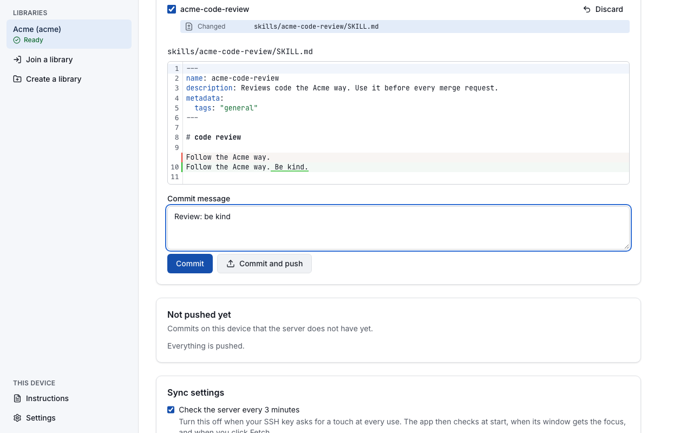
      </picture><br />
      <sub><b>Changes.</b> See exactly what changed before you commit.</sub>
    </td>
  </tr>
  <tr>
    <td width="50%" valign="top">
      <picture>
        <source media="(prefers-color-scheme: dark)" srcset="docs/media/screens/tools-dark.png" />
        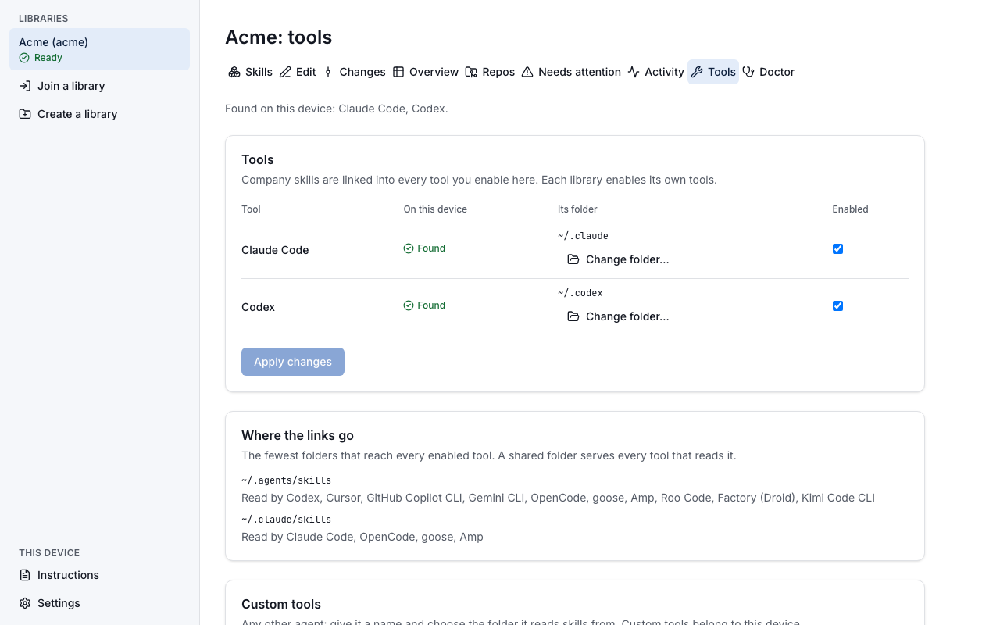
      </picture><br />
      <sub><b>Tools.</b> The AI tools found on this computer, and where the links go.</sub>
    </td>
    <td width="50%" valign="top">
      <picture>
        <source media="(prefers-color-scheme: dark)" srcset="docs/media/screens/instructions-dark.png" />
        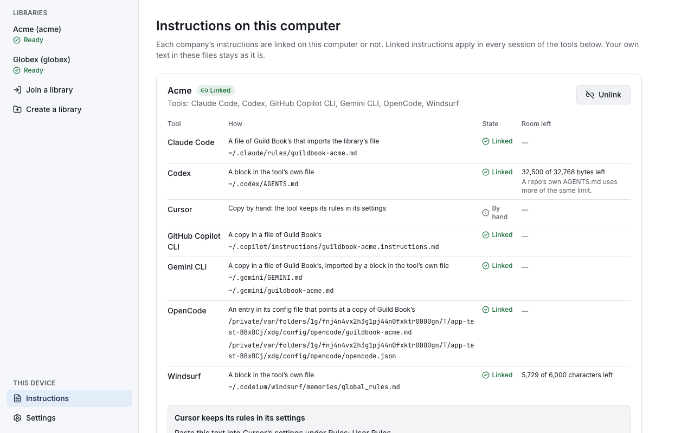
      </picture><br />
      <sub><b>Instructions.</b> A company's rules, and the tools that get them.</sub>
    </td>
  </tr>
</table>
</details>

## How it works

```text
  Your team's git repository           Guild Book                Your AI tools
  ┌────────────────────────┐        ┌───────────────┐        ┌───────────────────────────┐
  │ skills/acme-review/    │  pull  │ keeps a clone │  links │ ~/.claude/skills/         │
  │ skills/acme-deploy/    │ ─────▶ │ shows changes │ ─────▶ │ ~/.agents/skills/         │
  │ AGENTS.md              │ ◀───── │ asks first    │        │ your code repos           │
  └────────────────────────┘  push  └───────────────┘        └───────────────────────────┘
```

1. **Join.** Open your team's invite link, or paste the git address of the library. Choose your tools and your code repos.
   The app shows a summary of every change before it makes any.
2. **Use.** Each skill appears in the folders your AI tools read. The app checks the server for new changes every three minutes.
3. **Improve.** Edit a skill, in the app or through an AI tool. Review the change, commit and push. Your team pulls it.

## Works with

Claude Code · Codex · Cursor · GitHub Copilot CLI · Gemini CLI · OpenCode · Goose · Amp · Roo Code · Factory (Droid) ·
Kimi Code · Cline · Kilo Code · Kiro · Qwen Code · Windsurf (instructions only)

The folders come from each tool's documentation. The list is a catalog, and you can add any other agent as a custom
tool. **Help wanted:** the Doctor shows "Not verified" for a tool until someone has tested it end to end. Claude Code
is tested so far. Open an issue when you test another tool.

## Install

Download the installer for your system from the [Releases](../../releases) page.

| System                         | File                          | How                                                                                                    |
| ------------------------------ | ----------------------------- | ------------------------------------------------------------------------------------------------------ |
| macOS (Apple silicon or Intel) | `.dmg`                        | Open the file, and drag Guild Book to Applications.                                                    |
| Windows (x64 or Arm)           | `.exe`                        | Run the file. It installs the app for your user account, without administrator rights.                 |
| Linux (x64 or arm64)           | `.AppImage`, `.deb` or `.rpm` | The deb and the rpm add the app to your applications menu. Make an AppImage executable, then start it. |

The installers are not signed. The first time you open each new version, macOS and Windows warn you:

- **macOS:** the message says that Apple could not verify Guild Book. Click **Done**. Open **System Settings → Privacy &
  Security**, find the message about Guild Book, and click **Open Anyway**. Then type your password. After an update,
  macOS also asks for your password so that the app can read your saved sign-ins. Type it, and click **Always Allow**.
- **Windows:** the message says "Windows protected your PC". Click **More info**, then **Run anyway**. If your company
  blocks apps that are not signed, ask your IT department to allow Guild Book.

The app does not update itself. Once a day it checks for a new version, and **Settings → Updates** tells you when one
is available. Download and install it in the same way.

### Build from source

You need Node 24 and pnpm 12.

```bash
corepack enable pnpm
pnpm install
pnpm build:prod # the app for your system, in apps/desktop/release/
pnpm dev        # a development build, in a fresh and separate folder
```

## Privacy

The app reads only the folders you give it: the library, your tools' folders and your code repos. It sends no telemetry.
The daily update check asks GitHub for one small file: the update feed. Like every browser request,
it holds the app's name and version, your system type and your language, and GitHub sees your IP address. It holds no
ID, no name and no data from your library. A problem report is saved only when you choose, and you read the whole text
first. It has no file contents and no secrets.

## Status

This is the first release (1.0). The app is tested on macOS (Apple silicon) and Linux (arm64). It has not run on a
real Windows machine yet. Please [open an issue](../../issues) when something is wrong.

## Contributing

Issues and pull requests are welcome. Good first areas: testing more AI tools and testing on Windows.

## License

Guild Book is licensed under the [Apache NON-AI License, Version 2.0](LICENSE). It is the Apache License 2.0 with one
added condition: you may not use the software to create an AI training dataset, or in any way that contributes to the
training or development of an AI model or algorithm, unless the contributor gives you written permission.

Files from other projects keep their own licenses. See [NOTICE](NOTICE).

Built with [Electron](https://www.electronjs.org), [React](https://react.dev), TypeScript and
[dugite](https://github.com/desktop/dugite) (git).
